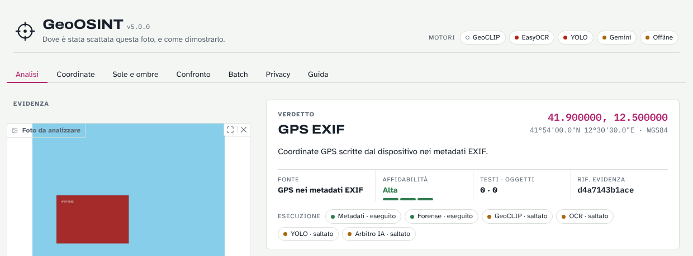
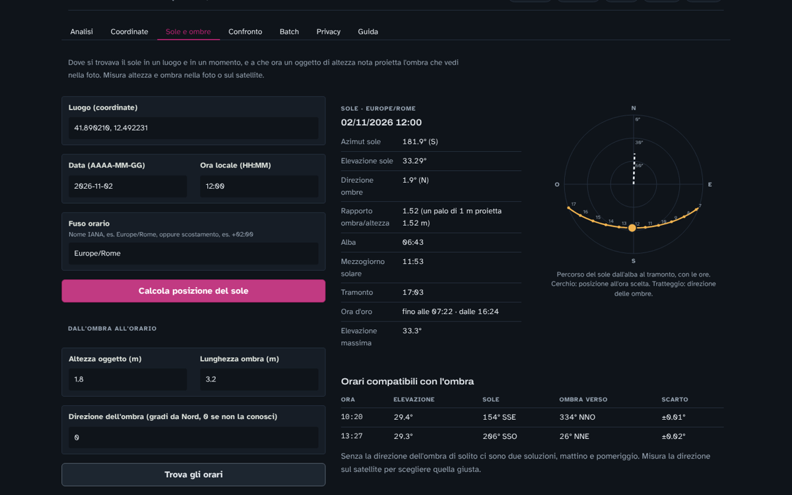
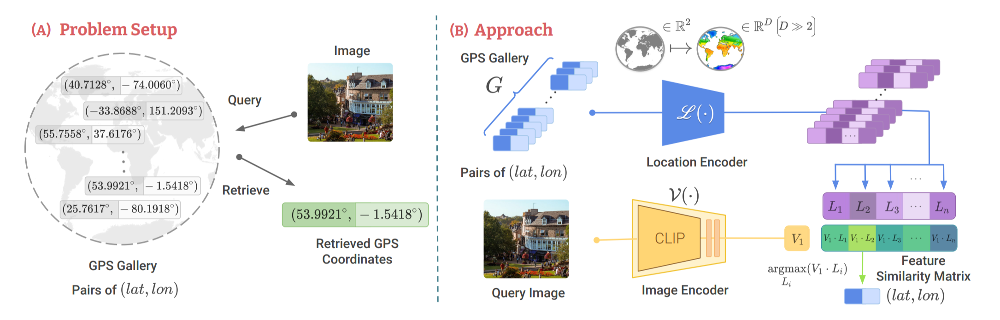

# GeoOSINT

Toolkit OSINT per la geolocalizzazione e la verifica di immagini.

[](https://github.com/Marchy02/Geo-clip-gui/actions/workflows/ci.yml)


Da una foto a una posizione **verificabile**: GeoCLIP stima dove è stata scattata, un arbitro IA (Gemini, Claude, OpenAI, Ollama… a scelta)
incrocia testi, oggetti e metadati, e gli strumenti forensi e di pivot ti aiutano a **confermare o smentire**.
Tutto da una dashboard web o da riga di comando, con report esportabili.

> Fork operativo del progetto accademico [GeoCLIP](https://github.com/VicenteVivan/geo-clip) (NeurIPS 2023).





---

## Funzionalità

| Area | Cosa fa |
|---|---|
| **Geolocalizzazione** | GeoCLIP top-k con dispersione dei candidati, preset *Mondo* o *Ucraina/Russia* (fine-tuned), reverse geocoding OpenStreetMap delle zone stimate |
| **Arbitro IA** | Un modello linguistico a tua scelta (Gemini, Claude, OpenAI, OpenRouter, Mistral, Ollama in locale… tramite [LiteLLM](https://github.com/BerriAI/litellm)) riceve immagine + GeoCLIP + OCR + oggetti + metadati + tue note; risponde con luogo, confidenza, indizi, ragionamento, ipotesi alternative e **fonti web citate** (ricerca web su Gemini e Claude) |
| **Impostazioni** | Pannello nella dashboard: provider IA con chiavi, endpoint e modelli (prova connessione, elenco modelli), opzioni predefinite dei motori, import/export della configurazione |
| **Verdetto ragionato** | Sceglie la fonte più affidabile (GPS EXIF, poi IA con prove, poi GeoCLIP), spiega il perché e segnala **discordanze** (es. GPS falsificato) |
| **Metadati** | EXIF completo, GPS (altitudine, direzione, ora UTC), XMP, chunk PNG, profilo ICC, miniatura; osservazioni su editing, date modificate, seriali esposti, ricompressione social |
| **Forense** | SHA-256/SHA-1/MD5 (catena di custodia), hash percettivi pHash/dHash/aHash, Error Level Analysis, mappa del rumore, stima qualità JPEG, **marker di immagini generate da IA** (C2PA, IPTC, Stable Diffusion/ComfyUI) |
| **Testo & oggetti** | OCR multilingua (EasyOCR, anche cirillico/arabo/CJK) con link di ricerca per ogni testo; YOLO con immagine annotata e classi utili alla geolocalizzazione |
| **Pivot** | 20+ link pronti: Google Maps/Street View, Mapillary, KartaView, Google Earth, Sentinel EO Browser, Esri Wayback, Overpass Turbo, GeoHack, PeakVisor, SunCalc… e ricerca inversa su Google Lens, Yandex, Bing, TinEye, Baidu (diretta se l'immagine ha un URL pubblico) |
| **Coordinate** | Converte da/verso decimale, DMS, DDM, UTM, Plus Code, Geohash, link Google/OSM/Bing/Apple; ricerca luoghi; distanza e azimut |
| **Cronolocalizzazione** | Posizione del sole (algoritmo NOAA), alba/tramonto/ora d'oro, diagramma del percorso solare, **da un'ombra all'orario** (altezza + lunghezza ombra ± direzione) |
| **Confronto** | Stessa immagine ricompressa/ritagliata? Quale versione è più vicina all'originale? |
| **Batch** | Cartelle intere → tabella, mappa comune, export CSV/JSON |
| **Privacy** | Mostra cosa rivela una tua foto e ne crea una copia senza metadati |
| **Report** | HTML autonomo (mappa, immagini, hash, log), JSON, Markdown — generati a ogni analisi |

Ogni motore è **opzionale e caricato al primo uso**: se manca un pacchetto o la chiave API, quel modulo viene
saltato e segnalato, il resto funziona.

---

## Installazione

Requisiti: **Python 3.10+**. Usa un ambiente virtuale.

```bash
git clone https://github.com/Marchy02/Geo-clip-gui.git
cd Geo-clip-gui
python -m venv .venv
source .venv/bin/activate        # Windows: .venv\Scripts\activate
```

**Installazione completa** (tutti i motori):

```bash
pip install -r requirements.txt
```

**Installazione modulare** — scegli solo ciò che ti serve:

| Comando | Include |
|---|---|
| `pip install -e .` | Core: dashboard, metadati, forense, coordinate, sole, confronto, privacy, report (niente GPU/ML) |
| `pip install -e ".[geoclip]"` | + GeoCLIP (torch, transformers) |
| `pip install -e ".[ocr,yolo]"` | + EasyOCR e YOLO |
| `pip install -e ".[ai]"` | + arbitro IA (LiteLLM: Gemini, Claude, OpenAI, Ollama…) |
| `pip install -e ".[heif]"` | + foto HEIC/HEIF di iPhone |
| `pip install -e ".[all]"` | tutto quanto sopra |

> **Solo CPU?** Installa prima PyTorch leggero: `pip install torch --index-url https://download.pytorch.org/whl/cpu`
>
> Al primo uso vengono scaricati automaticamente CLIP ViT-L/14 (~1,7 GB, da HuggingFace), i modelli EasyOCR e YOLOv8n.

### Provider IA (facoltativo, consigliato)

L'arbitro IA funziona con qualsiasi provider supportato da [LiteLLM](https://docs.litellm.ai/docs/providers).
Il modo più semplice è la scheda **Impostazioni → Provider IA** della dashboard:

1. scegli un modello predefinito (Google Gemini, Anthropic Claude, OpenAI, OpenRouter, Mistral, Groq, Ollama, LM Studio…)
   oppure un endpoint compatibile OpenAI;
2. incolla la chiave API, oppure indica il nome della variabile d'ambiente che la contiene;
3. premi *Carica modelli* per scegliere il modello e *Prova connessione* per verificarlo;
4. salva e, se vuoi, rendilo il provider predefinito.

Nella scheda *Analisi* puoi poi cambiare provider, modello o chiave per una singola analisi (la chiave di sessione non viene salvata).

Senza configurare nulla, resta valido il vecchio metodo: una chiave gratuita
su [Google AI Studio](https://aistudio.google.com/apikey) in `.env`:

```bash
cp .env.example .env    # e inserisci GEMINI_API_KEY=...
```

Allo stesso modo vengono lette le variabili standard degli altri provider (`ANTHROPIC_API_KEY`, `OPENAI_API_KEY`, `OPENROUTER_API_KEY`…).
Per Ollama in locale non serve alcuna chiave: basta un modello che accetti immagini (es. `ollama pull qwen2.5vl`).

### Docker

```bash
docker build -t geoosint .
docker run -p 7860:7860 --env-file .env -v geoosint-cache:/root/.cache -v geoosint-data:/data geoosint
```

Report e impostazioni salvate dalla dashboard finiscono nel volume `/data`.

---

## Uso

### Dashboard web

```bash
python app.py                 # oppure: geoosint ui
```

Apri <http://127.0.0.1:7860>. Opzioni utili: `--host 0.0.0.0` (rete locale), `--auth utente:password`,
`--share` (link pubblico temporaneo), `--inbrowser`.

### Riga di comando

```bash
geoosint analyze foto.jpg                          # analisi completa + report HTML/JSON in ./reports
geoosint analyze *.jpg --no-ai --format html md    # più file, senza IA
geoosint batch ./cartella -r --no-ocr --no-yolo    # intera cartella (ricorsiva)
geoosint exif foto.jpg --all                       # tutti i metadati e le osservazioni
geoosint hash foto.jpg                             # SHA-256 + hash percettivi
geoosint compare a.jpg b.jpg                       # stessa immagine?
geoosint strip foto.jpg -o foto_pulita.jpg         # rimuove i metadati
geoosint coords "45°26'27\"N 12°18'56\"E" --reverse --links
geoosint sun 41.89 12.49 --date 2024-06-21 --time 16:30 --tz Europe/Rome
geoosint shadow 41.89 12.49 --date 2024-06-21 --tz Europe/Rome --height 1.8 --length 2.0
geoosint status                                    # motori installati e configurazione
```

Aggiungi `--json` per un output leggibile da altri script. `python -m geoosint …` funziona allo stesso modo.

---

## Come si arriva al verdetto

```
                ┌─────────── Metadati (EXIF/XMP/GPS) ──────────┐
 immagine ──────┼─ Forense (hash, ELA, rumore, marker IA)      ├──► Arbitro IA (LLM a scelta + ricerca web)
                ├─ GeoCLIP top-k ──► reverse geocoding OSM     │            │
                ├─ OCR (testi) ────────────────────────────────┤            ▼
                └─ YOLO (oggetti) ─────────────────────────────┘      Fusione → verdetto + affidabilità
```

1. **GPS EXIF** presente → affidabilità *alta* (confrontata con l'IA: se dista molto, viene segnalata la discordanza).
2. **Arbitro IA con prove indipendenti** (testo letto, landmark, verifica web) → affidabilità in base alla confidenza.
3. **GeoCLIP** → stima statistica; affidabilità *media* solo se il primo candidato è netto e i candidati sono concentrati.

GeoCLIP è addestrato su 4,7 milioni di foto geotaggate (MP-16) e modella la Terra come funzione continua
tramite un *location encoder* a Random Fourier Features: restituisce una distribuzione di probabilità, non una certezza.



---

## Flusso di lavoro consigliato

1. **Analizza** l'immagine e leggi il verdetto *e la sua motivazione*.
2. **Verifica sul posto**: apri Street View / Mapillary / satellite dai link e confronta edifici, cartelli, pali, vegetazione, orizzonte.
3. **Pivota**: cerca i testi letti dall'OCR; lancia la ricerca inversa per trovare la copia più vecchia (spesso con contesto originale).
4. **Cronolocalizza** con la scheda *Sole e ombre*.
5. **Documenta**: scarica il report — l'hash SHA-256 identifica univocamente il file analizzato.

---

## Configurazione

Le impostazioni si leggono, in quest'ordine di priorità crescente:

1. valori predefiniti;
2. variabili d'ambiente o `.env` (vedi [`.env.example`](.env.example));
3. il file salvato dalla scheda **Impostazioni** della dashboard.

Il file è `~/.config/geoosint/settings.json` (Linux/macOS) o `%APPDATA%\GeoOSINT\settings.json` (Windows); la posizione
si cambia con `GEOOSINT_CONFIG`. Può contenere chiavi API, quindi viene scritto leggibile solo dal proprietario.
Dalla dashboard puoi esportarlo senza chiavi e reimportarlo su un'altra macchina; `geoosint status` mostra i provider configurati.

> **Dashboard esposta in rete?** Chi la apre può cambiare provider e chiavi. Proteggila con `--auth utente:password`
> oppure blocca le modifiche con `GEOOSINT_SETTINGS_LOCKED=true`.

| Variabile | Default | Descrizione |
|---|---|---|
| `GEMINI_API_KEY` | — | Chiave Google AI Studio (anche `GOOGLE_API_KEY`) per il provider Gemini predefinito |
| `GEMINI_MODEL` | `gemini-2.5-flash` | Modello del provider Gemini predefinito |
| `GEMINI_SEARCH` | `true` | Ricerca web (Google Search) per il provider Gemini predefinito |
| `ANTHROPIC_API_KEY`, `OPENAI_API_KEY`, … | — | Chiavi standard lette da LiteLLM se il provider non ne ha una salvata |
| `AI_PROVIDER` | `gemini` | Id del provider IA predefinito |
| `AI_TIMEOUT` | `120` | Timeout dell'arbitro IA in secondi |
| `GEOOSINT_CONFIG` | vedi sopra | Percorso del file delle impostazioni |
| `GEOOSINT_SETTINGS_LOCKED` | `false` | `true` = impostazioni in sola lettura dalla dashboard |
| `GEOCLIP_PRESET` | `world` | `world` o `ukraine_russia` |
| `GEOCLIP_TOP_K` | `5` | Candidati GeoCLIP |
| `OCR_LANGUAGES` | `en,it,de,fr,es` | Codici lingua EasyOCR |
| `YOLO_MODEL` / `YOLO_CONF` | `yolov8n.pt` / `0.35` | Modello e soglia YOLO |
| `ONLINE_LOOKUPS` | `true` | `false` = nessuna chiamata a OpenStreetMap |
| `REPORTS_DIR` | `reports` | Cartella dei report |
| `MAX_IMAGE_MB` | `40` | Dimensione massima immagine |
| `GRADIO_SERVER_NAME` / `GRADIO_SERVER_PORT` | `127.0.0.1` / `7860` | Server web |

---

## Struttura del progetto

```
geoosint/            # il tool
├── config.py        # impostazioni da env/.env + file salvato
├── user_config.py   # lettura/scrittura del file delle impostazioni
├── models.py        # strutture dati dei risultati
├── pipeline.py      # orchestrazione degli step + fusione
├── engines/         # GeoCLIP, EasyOCR, YOLO (caricamento lazy)
├── ai/              # arbitro IA: prompt, provider, chiamate via LiteLLM
├── forensics/       # metadati, hash, ELA, rumore, JPEG, sanitizzazione
├── geo/             # coordinate, link, geocoding, sole
├── report/          # export JSON / Markdown / HTML
├── ui/              # dashboard Gradio (tema, mappe, componenti, handler, impostazioni)
└── cli.py           # riga di comando
geoclip/             # motore neurale GeoCLIP (pesi, gallerie GPS, training)
notebooks/           # notebook di fine-tuning
tests/               # suite pytest (offline)
```

## Sviluppo

```bash
pip install -e ".[dev]"
pytest              # 80+ test, nessuna rete richiesta
ruff check . && ruff format geoosint tests
```

La CI esegue lint e test su Linux e Windows (Python 3.10 e 3.12) e un job dedicato ai pesi GeoCLIP.

---

## Uso responsabile

Strumento pensato per giornalismo, ricerca, verifica dei fatti e indagini legittime. Rispetta le leggi
sulla privacy (es. GDPR) e i termini d'uso dei servizi collegati. Ogni risultato automatico è un **indizio**,
non una prova: verifica sempre manualmente.

## Crediti

Il motore neurale è **GeoCLIP**. Se usi questo repository per ricerca, cita gli autori originali:

```bibtex
@inproceedings{geoclip,
  title={GeoCLIP: Clip-Inspired Alignment between Locations and Images for Effective Worldwide Geo-localization},
  author={Vivanco, Vicente and Nayak, Gaurav Kumar and Shah, Mubarak},
  booktitle={Advances in Neural Information Processing Systems},
  year={2023}
}
```

Dati cartografici © [OpenStreetMap](https://www.openstreetmap.org/copyright) contributors.
